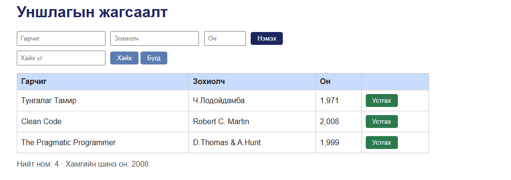

# BUG-01: Хуудас нээхэд "Нийт ном" тоолуур хүснэгтэд буй номын тооноос 1-ээр их харагдана

Орчин: Уншлагын жагсаалт v2.0, Google Chrome 155.0.8059.85, Windows (апп WSL2 Ubuntu дээр, node v23.11.0), 2026-10-20

Урьдчилсан нөхцөл: node app.js-ийг шинээр асаасан (анхны 3 ном)

## Дахин гаргах алхам

1. Терминалд `node app.js` ажиллуулна (шинээр асаасан).
2. Браузераар http://localhost:3000 нээнэ.
3. Хүснэгтийн мөрийг тоолно, дараа нь хүснэгтийн доорх "Нийт ном" тоог уншина.

Хүлээгдэж байсан: "Нийт ном" тоолуур хүснэгтэд буй номын тоотой тэнцүү байх ёстой (спецификац: «Нийт ном» тоолуур хүснэгтэд буй номын тоотой тэнцүү) - 3 ном байхад 3.

Бодит үр дүн: Хүснэгтэд 3 ном (Тунгалаг Тамир, Clean Code, The Pragmatic Programmer) байхад "Нийт ном: 4" гэж харагдана.

Ноцтой байдал: Major - хэрэглэгчид буруу тоон мэдээлэл харуулж байна, хуудас нээмэгц алдаа гарна.

Хавсралт: 

Олдсон аялал: Fed-Ex (өгөгдлийн зам: тоолуур ба хүснэгтийг харьцуулах)
