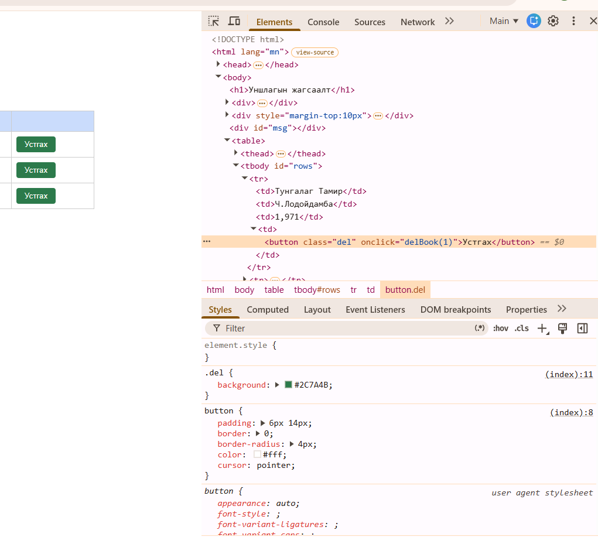

# BUG-02: "Устгах" товч ногоон өнгөтэй байна (улаан байх ёстой)

Орчин: Уншлагын жагсаалт v2.0, Google Chrome 155.0.8059.85, Windows (апп WSL2 Ubuntu дээр, node v23.11.0), 2026-10-20

Урьдчилсан нөхцөл: node app.js-ийг шинээр асаасан (анхны 3 ном)

## Дахин гаргах алхам

1. `node app.js` шинээр асааж http://localhost:3000 нээнэ.
2. Хүснэгтийн аль нэг "Устгах" товч дээр хулганы баруун товч дарж "Inspect" (Шалгах) сонгоно.
3. DevTools-ийн Styles хэсгээс `.del` дүрмийг хараад `background` утгыг уншина.

Хүлээгдэж байсан: Аюултай үйлдлийн товч (Устгах) улаан өнгөтэй байх ёстой (спецификац: «Аюултай үйлдлийн товч (Устгах) улаан өнгөтэй»).

Бодит үр дүн: `.del { background: #2C7A4B; }` - энэ нь ногоон өнгө (hex-ийн дунд хос 7A хамгийн их), улаан биш.

Ноцтой байдал: Minor - товч ажиллаж байгаа ч аюултай үйлдлийг өнгөөр анхааруулах дүрэм зөрчигдсөн.

Хавсралт: 

Олдсон аялал: Анхны үзлэг (хуудсыг спецификацтай харьцуулсан), charter-ийн аялалаас гадуур
