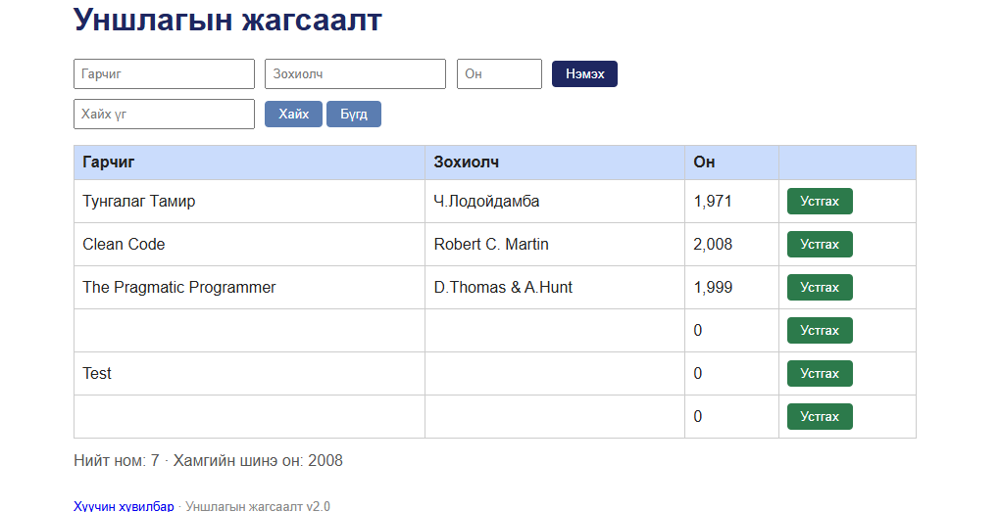

# BUG-03: Талбар хоосон (эсвэл дутуу) үед "Нэмэх" дарахад ном нэмэгдэж, он 0 болно

Орчин: Уншлагын жагсаалт v2.0, Google Chrome 155.0.8059.85, Windows (апп WSL2 Ubuntu дээр, node v23.11.0), 2026-10-20

Урьдчилсан нөхцөл: node app.js-ийг шинээр асаасан (анхны 3 ном)

## Дахин гаргах алхам

1. `node app.js` шинээр асааж http://localhost:3000 нээнэ.
2. Гарчиг, Зохиолч, Он гурван талбарыг бүгдийг хоосон үлдээнэ.
3. "Нэмэх" товч дарна.
4. Хүснэгтийн доод хэсгийг харна.
5. (Хувилбар) Зөвхөн Гарчиг талбарт `Test` бичиж, бусдыг хоосон үлдээгээд "Нэмэх" дарна.

Хүлээгдэж байсан: Гурван талбар бүгд заавал бөглөгдсөн байх ёстой; дутуу бол ном нэмэгдэхгүй, ойлгомжтой алдааны мессеж харагдана (спецификац).

Бодит үр дүн: Хоосон гарчиг, хоосон зохиолч, он `0` бүхий ном хүснэгтэд нэмэгдэнэ, алдааны мессеж харагдаагүй. Зөвхөн `Test` гарчигтай үед гарчиг нь `Test`, зохиолч хоосон, он `0` бүхий ном нэмэгдэнэ.

Ноцтой байдал: Major - өгөгдлийн шалгалт байхгүй тул хуурамч бичлэг хүснэгтэд орно.

Хавсралт:  (зураг дээр 2 алхмын хоосон мөр ба 5-р алхмын `Test` мөр хоёулаа харагдана)

Олдсон аялал: Couch Potato (хоосон оролт)
