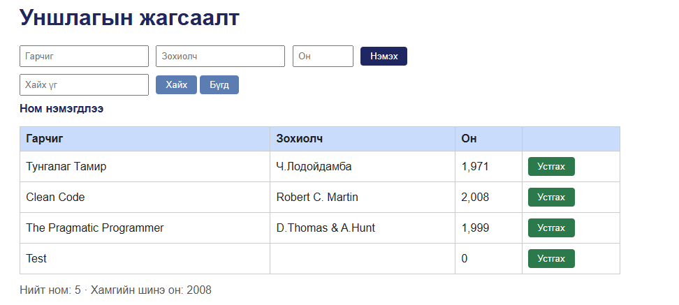

# BUG-05: Ном устгахад "Ном нэмэгдлээ" гэсэн буруу мессеж гарна

Орчин: Уншлагын жагсаалт v2.0, Google Chrome 155.0.8059.85, Windows (апп WSL2 Ubuntu дээр, node v23.11.0), 2026-10-20

Урьдчилсан нөхцөл: node app.js-ийг шинээр асаасан (анхны 3 ном)

## Дахин гаргах алхам

1. `node app.js` шинээр асааж http://localhost:3000 нээнэ.
2. Хүснэгтийн аль нэг мөрийн "Устгах" товч дарна.
3. Хүснэгтийн дээрх мессежийг уншина.

Хүлээгдэж байсан: Үйлдэл бүрийн дараах мессеж тухайн үйлдэлдээ тохирно (спецификац) - устгасны дараа устгасан тухай мессеж.

Бодит үр дүн: Устгасны дараа "Ном нэмэгдлээ" ("Book added") гэсэн мессеж гарна. Дахин нэг ном устгахад мөн адил "Ном нэмэгдлээ" гарна.

Ноцтой байдал: Minor - өгөгдөл зөв устгагдаж байгаа ч хэрэглэгчид буруу мэдээлэл өгч төөрөгдүүлнэ.

Хавсралт:  (зураг нь хоёр дахь устгалын дараах төлөв)

Олдсон аялал: Fed-Ex (нэмэх-хайх-устгах өгөгдлийн зам)
